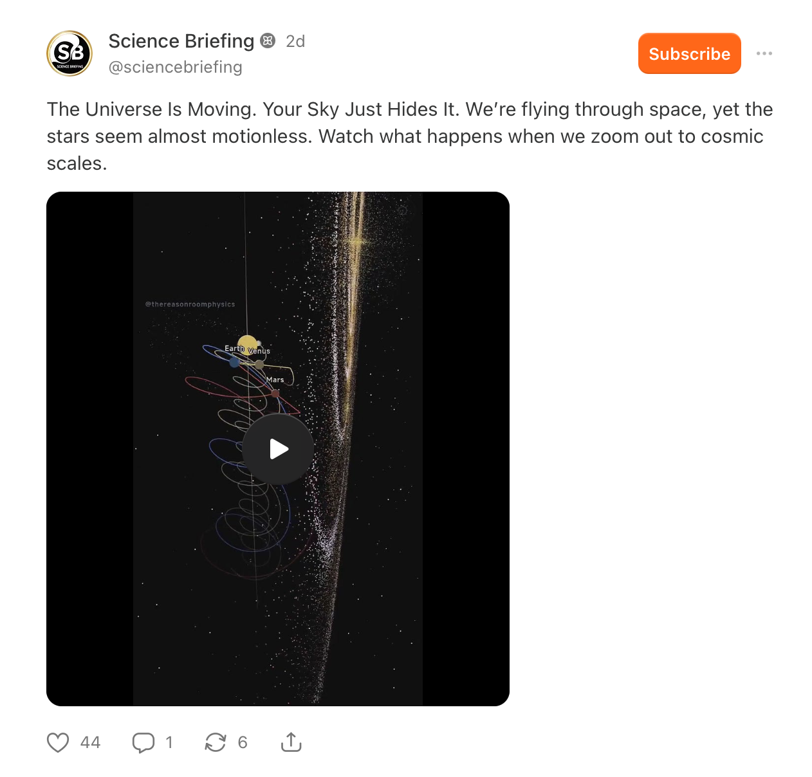

## Agenda

- Finance Committee report (Chris, Rick)
- Officer elections
- The year ahead

## Finance Committee report

| Activity  |  Type   | Amount   |
|-----------|---------|----------:|
| BFSP^[Black Forest Star Party]      |         |           |
|           | Income  |  28,452   |
|           | Expense | 20,935    |
|           | NET     | 7,517     |

## Officer elections

- Peter Ahnert, Nominating Committee chair
- *n*=50 active members^[Dues-paying or comped via 2026 BFSP service] may vote

## Officer candidate slate

| Office  |  Candidate   | Prior service |
|-----------|---------|---------|
| President | Rick Gilmore  | VP 2025; President 2025-26 |
| Vice President | Peter Ahnert   | VP 2026 |
| Secretary      | Jim Bennett | Member |
| Treasurer      | Jim Barber   | Member |

- Thank you Carol Tancibok (outgoing Secretary) & Chris McMullen (outgoing Treasurer)!

## The year ahead

:::: {.columns}
::: {.column width=50%}
- BFSP 2027
- Skywatches @ Penn State
- Your ideas?
:::
::: {.column width=50%}
- Migration to groups.io
- Annual budget
- Bylaws refresh
- Monthly board meetings (3rd Thursday)
- Business meetings (Feb, May, Aug, Nov?)
:::
::::

## {.center}

{fig-align="center"}
